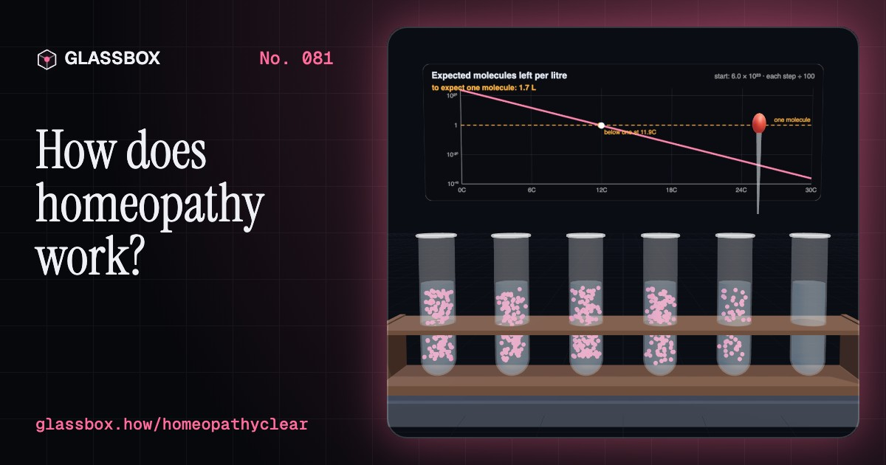
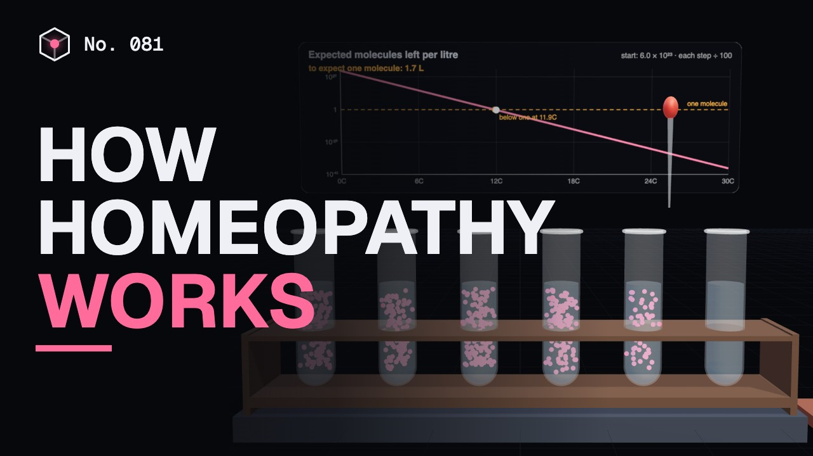
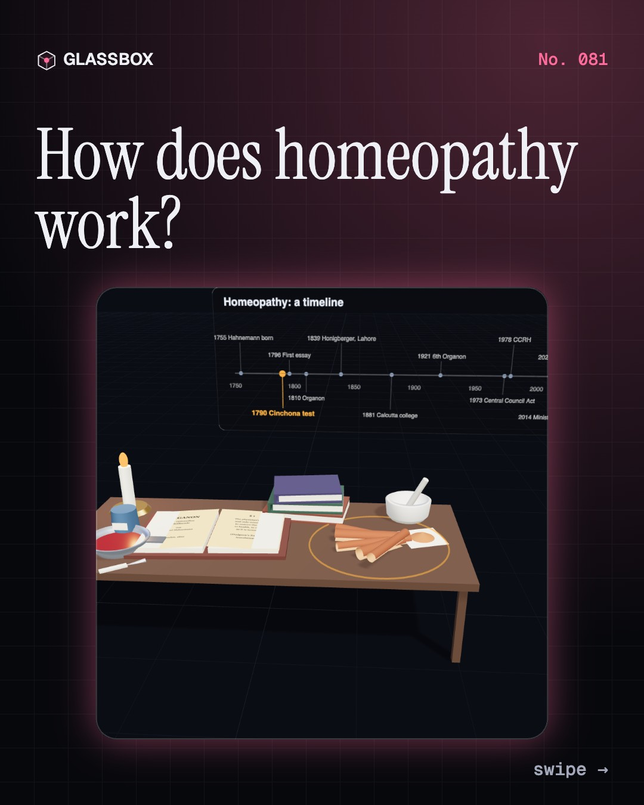
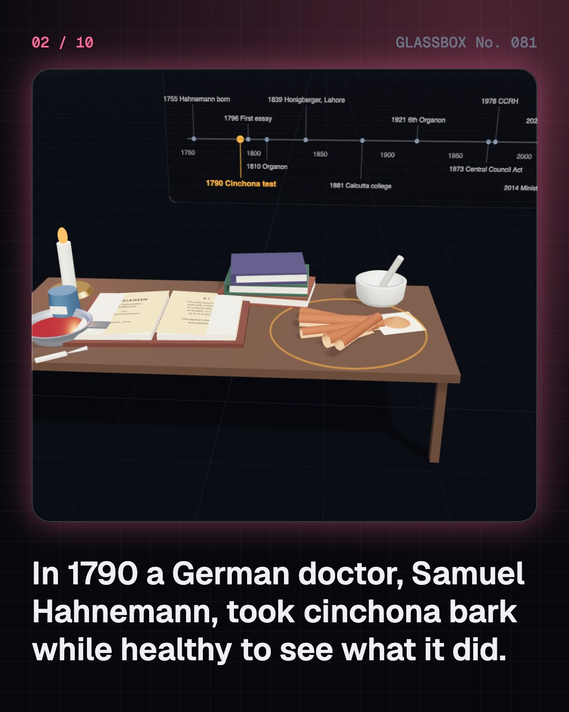
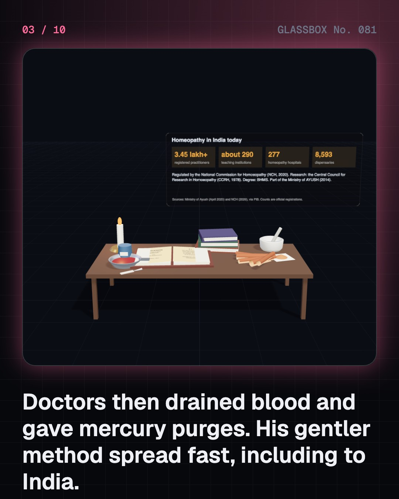
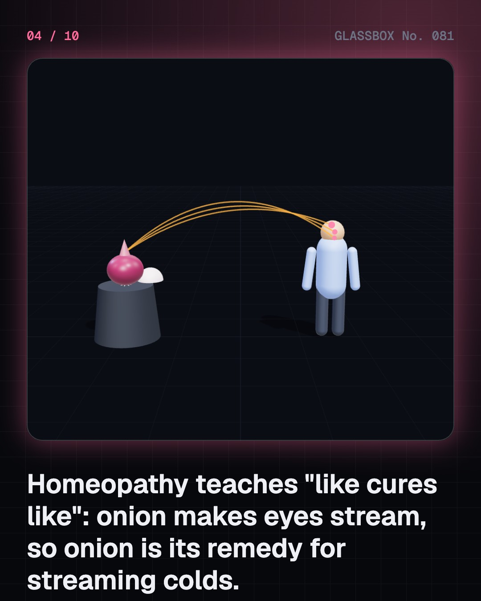

<!-- glassbox:start -->
<!-- Generated from glassbox.json by the Glassbox hub (npm run readme -- homeopathyclear). Edit glassbox.json, not this block. -->
<p align="center"><a href="https://glassbox-production-fd52.up.railway.app/e/homeopathyclear/"></a></p>

<h1 align="center">HomeopathyClear</h1>

<p align="center"><b>How does homeopathy work?</b><br>Dilute a remedy 1 in 100, shake it, and repeat thirty times. Count the molecules with Avogadro's number, watch them run out at 12C, find out why 30C would need 10¹⁵ oceans to hold one, then run a fair test against a dummy pill.</p>

<p align="center"><a href="https://glassbox-production-fd52.up.railway.app/homeopathyclear/"><b>▶ Play with it</b></a> &nbsp;·&nbsp; <a href="https://glassbox-production-fd52.up.railway.app/e/homeopathyclear/">Read the 60-second explainer</a> &nbsp;·&nbsp; <a href="https://glassbox-production-fd52.up.railway.app/homeopathyclear/glassbox/reel.mp4">Watch the 40-second video</a></p>

<p align="center">
  <a href="https://glassbox-production-fd52.up.railway.app/e/homeopathyclear/"></a>
  <a href="https://glassbox-production-fd52.up.railway.app/e/homeopathyclear/"></a>
  <a href="LICENSE"></a>
  <a href="LICENSE-CONTENT.md"></a>
  <a href="#privacy"></a>
</p>

## In 60 seconds

1. **A gentler medicine, from 1790.** Samuel Hahnemann took cinchona bark while healthy, felt fever-like symptoms, and built homeopathy on it. Around 1800 doctors bled patients and gave mercury purges, so gentle remedies caught on, and homeopathy reached India in the 1830s.
2. **Like cures like, as homeopathy describes it.** Homeopathy teaches that a substance that causes symptoms in a healthy person, found in "provings", treats similar symptoms in the sick. A long consultation matches one remedy to the whole person, in the smallest dose.
3. **Dilute and shake until nothing is left.** Each C step is 1 part in 100 with hard shaking. A mole holds 6.022 × 10²³ molecules, so by 12C most bottles hold none, and 30C would need about 10¹⁵ Earth oceans to hold one. "Water memory" failed blinded tests.
4. **From plant to sugar pill.** A mother tincture is plant material soaked in alcohol. Insoluble things are ground with milk sugar. Drops of the dilution are soaked into sugar globules, and a repertory links symptoms to remedies.
5. **What fair tests show.** Many people get better anyway, and people visit healers on their worst days. Randomised, blinded trials compare with a dummy pill. Australia's NHMRC found no condition with reliable evidence it beats placebo; homeopaths and India's CCRH dispute this.
6. **Use it wisely.** The pills themselves carry little risk; delaying real treatment does. Never stop prescribed medicine, see a qualified doctor for serious illness, and keep vaccines up to date. Many choose homeopathy to feel heard: an Indian GP visit averages about 2 minutes.

## Words worth knowing

| Term | Meaning |
|---|---|
| **Homeopathy** | A system of medicine founded by Samuel Hahnemann around 1796, built on "like cures like" and highly diluted remedies. |
| **Similia similibus curentur** | "Let like be cured by like": homeopathy's principle that what causes symptoms in the healthy treats them in the sick. |
| **Proving** | A test in which healthy volunteers take a substance and record their symptoms. |
| **Potentisation** | Repeated dilution with vigorous shaking (succussion). 30C means 1 part in 10⁶⁰. |
| **Avogadro's number** | 6.022 × 10²³, the number of particles in one mole of a substance. |
| **Mother tincture (Ø)** | The starting liquid for a plant remedy: plant material soaked in alcohol and filtered. |
| **Repertory** | An index of symptoms, each listing the remedies linked to it. |
| **Placebo** | A dummy treatment. Fair tests compare a remedy with one to see if it adds anything. |
| **Regression to the mean** | After an unusually bad day, the next ones tend to be closer to normal, with or without treatment. |

## A short history

**From a German doctor's dose of bark in 1790 to one of India's official systems of medicine, tested along the way by chemistry and clinical trials.**

- **1790** · The cinchona bark experiment (Samuel Hahnemann, Leipzig, Saxony)
- **1810** · The Organon (Samuel Hahnemann, Dresden)
- **1829** · Honigberger at the Lahore court (Johann Martin Honigberger, Lahore, Sikh Empire)
- **1881** · The Calcutta Homoeopathic Medical College (P. C. Majumdar and D. N. Roy, Calcutta (Kolkata))
- **1973** · Homoeopathy Central Council Act (Parliament of India, New Delhi)
- **1988** · "Water memory" in Nature (Jacques Benveniste's laboratory, Clamart)
- **2005** · The Lancet's big comparison (Aijing Shang, Matthias Egger and colleagues, Bern)
- **2015** · Australia's NHMRC review (National Health and Medical Research Council, Canberra)

The full story, with 30 moments, charts, people and 31 sources: [glassbox.how/e/homeopathyclear/history](https://glassbox-production-fd52.up.railway.app/e/homeopathyclear/history/). The data lives in [`history.json`](history.json).

## Video and slides

Made with the Glassbox studio from this box's storyboard (`window.glassbox.director`). Free to reuse under CC BY 4.0.

<a href="https://glassbox-production-fd52.up.railway.app/homeopathyclear/glassbox/video.mp4"></a>

<p><a href="glassbox/slide-1.jpg"></a> <a href="glassbox/slide-2.jpg"></a> <a href="glassbox/slide-3.jpg"></a> <a href="glassbox/slide-4.jpg"></a></p>

| File | What | Size |
|---|---|---|
| [`glassbox/reel.mp4`](https://glassbox-production-fd52.up.railway.app/homeopathyclear/glassbox/reel.mp4) | Reel / Short, with captions and soundtrack | 1080×1920 |
| [`glassbox/video.mp4`](https://glassbox-production-fd52.up.railway.app/homeopathyclear/glassbox/video.mp4) | YouTube video, with captions and soundtrack | 1920×1080 |
| `glassbox/slide-1…10.jpg` | Instagram carousel | 1080×1350 |
| `glassbox/thumb.jpg` | YouTube thumbnail | 1280×720 |
| `glassbox/cover.jpg` | Share card and repo social preview | 1200×630 |
| [`glassbox/history-reel.mp4`](https://glassbox-production-fd52.up.railway.app/homeopathyclear/glassbox/history-reel.mp4) | “History in 10 moments” Reel / Short | 1080×1920 |
| `glassbox/history-slide-*.jpg` | History carousel | 1080×1350 |
| `glassbox/post.json` | Post copy and schedule used by the publish kit | |

## Privacy

This box has no accounts and no ads, and it ships its own fonts and libraries. When you run it yourself it sends nothing anywhere. On glassbox.how, the site's `/bar.js` also loads Glassbox's analytics: **Google Analytics** to count visits (it asks first in the EU, UK and Switzerland, and stays off when your browser sends Global Privacy Control or Do Not Track) and **ClickTrust** to detect bots.

It remembers a few things **in your own browser only**, and never sends them anywhere:

| Browser storage key | What it holds |
|---|---|
| `homeopathyclear.v1` | Which chapters you have opened, your best quiz scores, and sound on or off. |

Exactly what each one sees is at [glassbox.how/privacy](https://glassbox-production-fd52.up.railway.app/privacy/).

## Licences

- **Code:** [MIT](LICENSE). Use it, change it, ship it.
- **Explanations, text, images and videos** (`glassbox.json`, `glassbox/`): [CC BY 4.0](LICENSE-CONTENT.md). Credit “Glassbox, glassbox.how/e/homeopathyclear”.
- **Third-party parts** keep their own licences: [three.js](https://threejs.org) (MIT), [Geist, Instrument Serif](https://openfontlicense.org) (SIL OFL 1.1).
- The Glassbox name and logo aren't covered by either licence. See the [terms](https://glassbox-production-fd52.up.railway.app/terms/).

Found a mistake? [Open an issue](https://github.com/bdeeps/homeopathyclear/issues). Corrections happen in public.
<!-- glassbox:end -->

## Run it

It's plain HTML, CSS and JavaScript. No build step and no dependencies. Run locally, it contacts no other website.

```bash
python3 -m http.server 8000
```

Three.js and the fonts ship in `vendor/` and `fonts/`, so it also works offline.

Then open http://localhost:8000.

## How it's built

| File | What |
|---|---|
| `index.html`, `css/app.css` | The page and its styles |
| `js/app.js`, `js/stage.js`, `js/ui.js`, `js/kit.js` | The shared Glassbox 3D engine: chapters, 3D stage, controls, quiz, video director |
| `js/homeo.js` | Shared parts: the dilution maths (Avogadro's number, in log10 so 200C doesn't underflow), number formatting, chart boards and the test tubes, vials, books and figures |
| `js/chapters/*.js` | One file per chapter: the 3D model, controls, text, key terms, quiz and video scenes |
| `glassbox.json` | Title, question, explainer beats, key terms, browser storage and credits shown on glassbox.how |
| `reel` in each chapter | The storyboard the Glassbox studio records into short videos |
| `glassbox/` | The published video, slides, thumbnail and post copy |
| `fonts/`, `vendor/three/` | Self-hosted Geist and Instrument Serif (SIL OFL 1.1) and three.js (MIT) |
